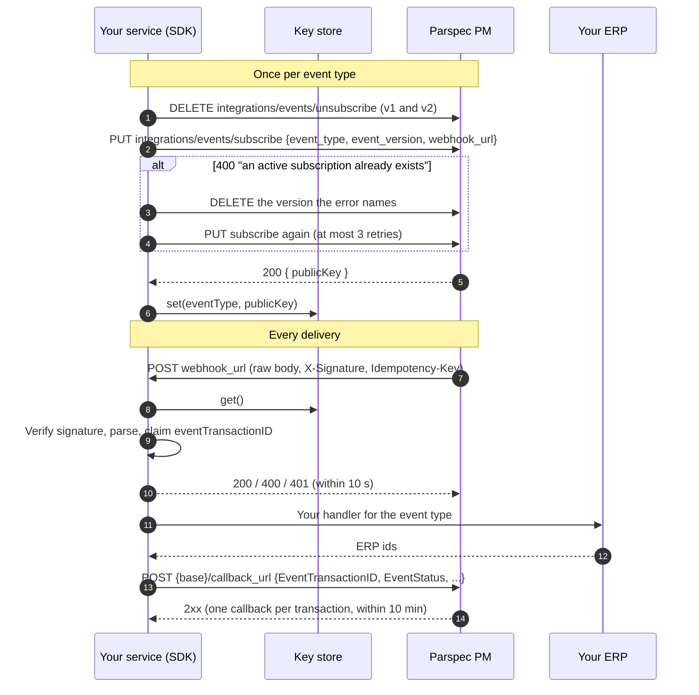
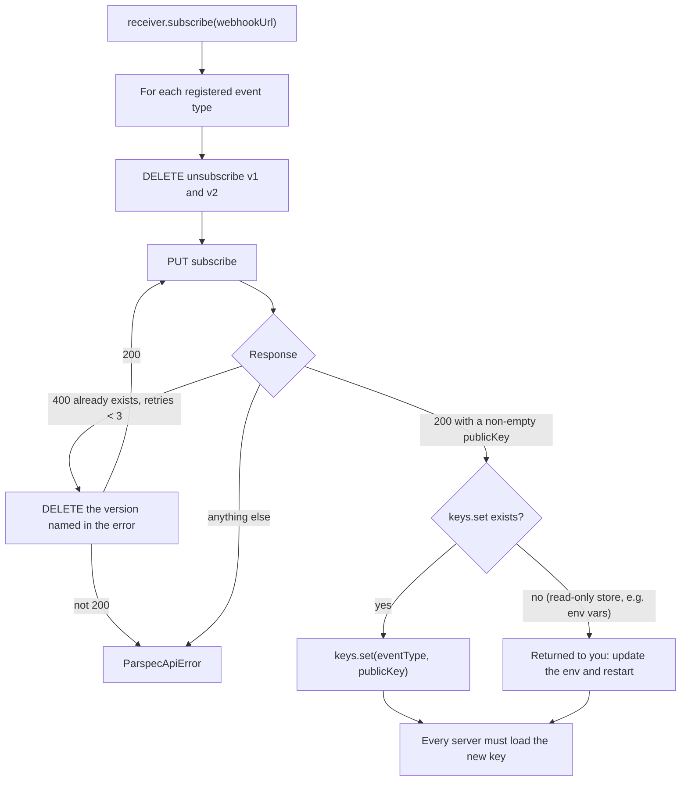
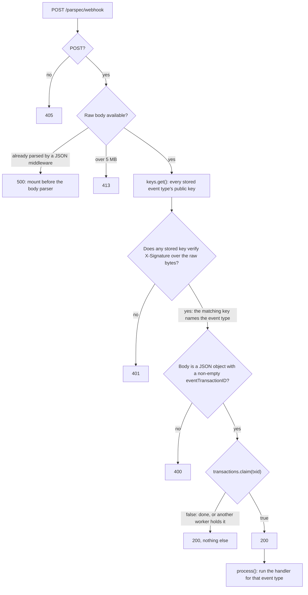
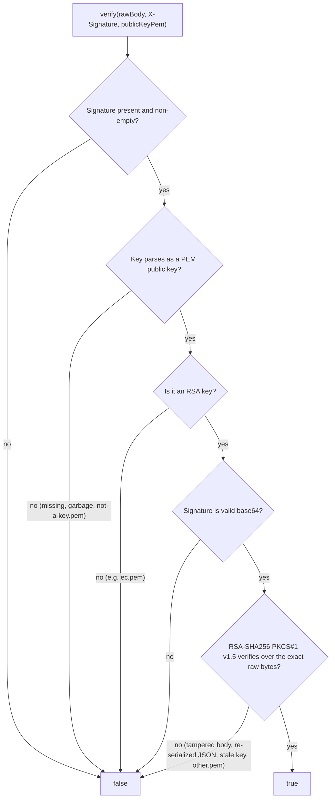
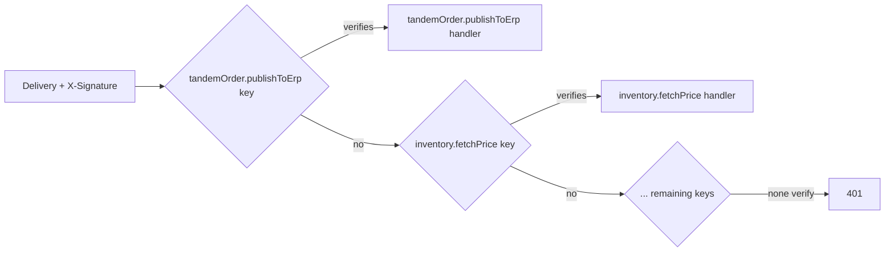
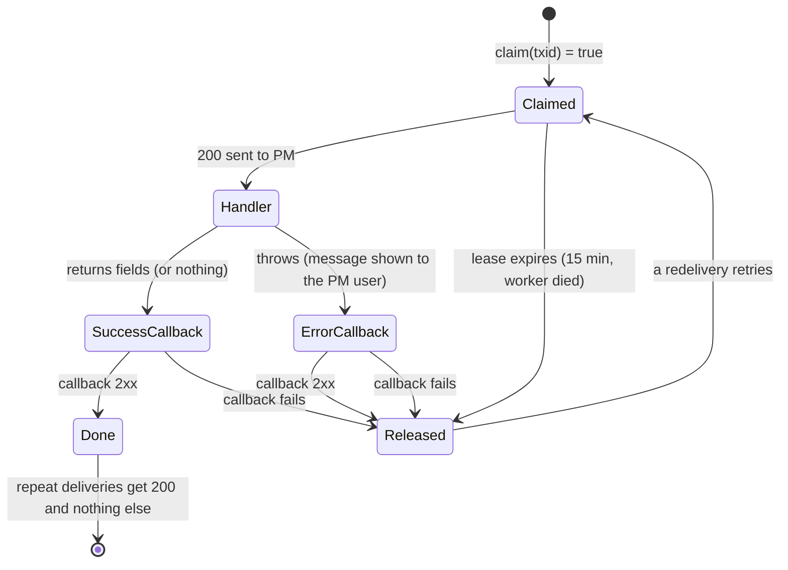

# Event flow and key validation

How a PM event gets from PM to your ERP and back, and how each delivery's signing key is checked. The rules themselves are in [PROTOCOL.md](PROTOCOL.md); this is the same thing as diagrams.

## The whole flow

## Subscribe: where the keys come from

Every subscribe mints a new RSA key pair in PM and returns the public half. Deliveries are signed with the new key from then on, so the old key stops verifying.

## Receiving a delivery

`accept` is the fast phase that decides the HTTP answer; `process` runs after the answer is sent.

## Key validation

`verify(rawBody, signature, publicKeyPem)` is the only check on who sent a delivery. It returns true or false and never throws. All four SDKs behave the same way, and `fixtures/signatures.json` pins every branch below.

What makes a signature fail, and what to do about it:

| Cause | Why it fails | Fix |
|---|---|---|
| Body went through a JSON parser first | Re-serialized JSON has different bytes | Pass the bytes exactly as received (`express.raw()`, or mount the SDK handler before any parser) |
| Stale key | You resubscribed and PM now signs with the new key | Reload keys on every server after each subscribe |
| Key for a different event | No stored key matches, so the delivery can't be routed | Store one key per event type, from that event's subscribe |
| Wrong environment | Sandbox keys don't verify production deliveries | Subscribe and store keys per environment |
| Not from PM | Nobody else holds PM's private key | Nothing: the 401 is correct |

### Routing by key

Several event types can share one webhook URL. The delivery doesn't say which event it is in a header, so the receiver tries each stored key in turn; the first that verifies identifies the event type. That's why each event type needs its own key in the store, and why a stale key surfaces as a 401 rather than a misrouted event.

The keys are **public** keys, so storing them isn't a secret-handling problem: env vars, a config file or a database row are fine. The secret is your PM API key, which the SDK sends only to the configured PM origin.

## After the answer: handler, callback, settle

The callback always carries `EventTransactionID` and `EventStatus` set by the SDK, after your fields, so a handler can't forge them. A `callback_url` that's an absolute URL on another host is refused before anything is sent, because the API key goes with every callback.
